# Theme re-evaluation: Sumi vs Retypeset with a Taiwan-standard font

Date: 2026-11-04 · Task: [#122](https://github.com/januswtlin/januslin.me/issues/122) · Role: Site Engineer · Draft decision: [ADR-0019](../decisions/ADR-0019-sumi-theme.md) (proposed)

## Summary

- **Sumi is [kpab/astro-sumi](https://github.com/kpab/astro-sumi)**, MIT, native Astro 7. Its upstream is young (first commit 2026-08-04, last commit 2026-08-29) and has one maintainer.
- With the same Taiwan-standard font (Noto Serif TC) in both themes, the comparison below is about layout only. Screenshots are in the [side-by-side sheet](#side-by-side-sheet).
- Sumi has no gap that blocks us. KaTeX and build-time Mermaid work in Sumi with the same unified pipeline as PR #121 ([trial](#katex-and-mermaid-on-sumi)). Its missing parts are i18n, CJK typesetting rules, callouts, search, and a CJK OG font. Each has a bounded fix, and T11–T13 rebuild most of those areas on either theme anyway.
- **Recommendation: move to Sumi**, because the author prefers its layout and no gap blocks it. It costs roughly one extra medium-sized task compared with finishing on Retypeset: re-doing T09 for Sumi, plus a CJK typesetting port and i18n chrome in T11. PR #121's test harness carries over. The decision is the author's.
- Two findings apply to either theme. Noto Serif TC as packaged costs about 1.0–1.2 MB of fonts on first load, against T09's 400 KB budget, so it needs build-time subsetting. And on PR #121, `remark-directive` parses the `:15` in `1:15` as a directive that nothing handles, so it becomes an empty `
` and splits the paragraph.

## 1. Sumi upstream, license, and Astro compatibility

| Item | Finding | Evidence |
|---|---|---|
| Repository | `kpab/astro-sumi`, demo `https://sumi.p4ni.com` (not opened: not on the sandbox allowlist). The author confirmed on 2026-11-04 that this is the theme listed on astro.build. | [repository](https://github.com/kpab/astro-sumi) |
| License | MIT, © kpab. Bundled fonts: Source Serif 4 (Adobe) and JetBrains Mono, both SIL OFL 1.1, with the license shipped next to them. | [`LICENSE`](https://github.com/kpab/astro-sumi/blob/c6bbdd91417cb0a624e7abbb570544c951ac5c6f/LICENSE), [`public/fonts/LICENSE.txt`](https://github.com/kpab/astro-sumi/blob/c6bbdd91417cb0a624e7abbb570544c951ac5c6f/public/fonts/LICENSE.txt); GitHub API `license.spdx_id: MIT` |
| Commit evaluated | `c6bbdd91417cb0a624e7abbb570544c951ac5c6f` (2026-08-29, "chore: bump the version to 1.0.0"), tag `v1.0.0`, the head of `main` on 2026-11-04 | [commit](https://github.com/kpab/astro-sumi/commit/c6bbdd91417cb0a624e7abbb570544c951ac5c6f) |
| Astro version | Declares `astro ^7.1.6`, Node `>=22.12.0`. The spike resolved Astro **7.4.5**, the same version as PR #121. On Node 24.22.2 and pnpm 12.16.1, `astro build` ran with no warnings and `astro check` reported 0 errors, 0 warnings, 0 hints. | [`package.json`](https://github.com/kpab/astro-sumi/blob/c6bbdd91417cb0a624e7abbb570544c951ac5c6f/package.json) |
| Maintenance | 39 commits by one author: 37 on 2026-08-04/05, then two on 2026-08-29. 16 stars, 7 forks, 1 PR and 1 issue in total, none open. Its own CI runs type check and build on Node 24. | [commits](https://github.com/kpab/astro-sumi/commits/main), [`ci.yml`](https://github.com/kpab/astro-sumi/blob/c6bbdd91417cb0a624e7abbb570544c951ac5c6f/.github/workflows/ci.yml) |
| Size | 42 files under `src/` at `c6bbdd9`, including its six sample posts and the OG font `.ttf` (36 without the sample posts). Plain CSS with design tokens (`src/styles/tokens.css`), no CSS framework. Retypeset at PR #121's `1b40b32` has 61 files under `src/` (its posts live in `tests/fixtures/`), with UnoCSS. | [tree at `c6bbdd9`](https://github.com/kpab/astro-sumi/tree/c6bbdd91417cb0a624e7abbb570544c951ac5c6f/src); `git ls-tree -r 1b40b32 src` |
| Markdown | Astro 7's default Sätteri processor, with no remark/rehype plugins. TOC comes from `render()` headings, and reading time is computed from the body. | [`astro.config.ts`](https://github.com/kpab/astro-sumi/blob/c6bbdd91417cb0a624e7abbb570544c951ac5c6f/astro.config.ts), [README "Writing posts"](https://github.com/kpab/astro-sumi/blob/c6bbdd91417cb0a624e7abbb570544c951ac5c6f/README.md#writing-posts) |

The upstream also ships an `AGENTS.md` and `.vscode/`. A vendoring task drops both, as T09 did for Retypeset's extras.

### KaTeX and Mermaid on Sumi

ADR-0001 kept the unified pipeline because Sätteri has no KaTeX or Mermaid plugins. Sumi depends on no Markdown plugins, so switching it to unified costs nothing. I tested that in the spike: `markdown.processor: unified({ remarkPlugins: [remarkMath], rehypePlugins: [rehypeKatex, [rehypeMermaid, { strategy: 'inline-svg' }]] })` with the same versions as PR #121 (`@astrojs/markdown-remark` 7.3.5, `remark-math` 6.0.0, `rehype-katex` 7.0.1, `rehype-mermaid` 3.0.0, `playwright` 1.64.1), plus `katex/dist/katex.min.css` in the post layout. Results on PR #121's fixture post (`tests/fixtures/site/posts/fixture-post.md` on that branch):

- the build has no warnings;
- KaTeX: 2 `.katex` elements and 1 `.katex-display`;
- Mermaid: 1 inline `<svg id="mermaid-0">` and no `pre.mermaid`;
- footnotes render, and Sumi's TOC still lists every heading;
- no requests to other hosts.

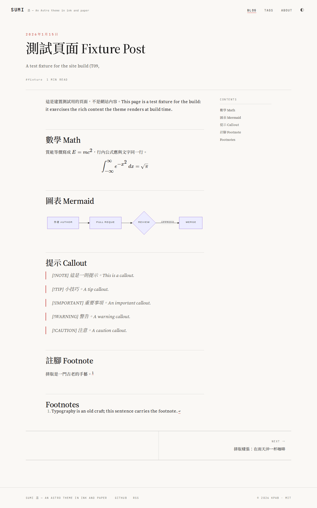

Two problems the trial showed:

1. **Callouts.** GitHub-style alerts (`> [!NOTE]`) render as an italic quote with the literal `[!NOTE]` text, on both Sätteri and unified. Retypeset's own callout plugins (`remark-container-directives.mjs`, and the `:::note` directives that `docs/content-model.md` names) are unified plugins. Port them, or add a GitHub-alerts rehype plugin, plus CSS. Size: S.
2. **Mermaid labels.** Mermaid emits `` inside its SVG, and Sumi's global `.label` helper applies to it. That helper is in [`src/styles/global.css`](https://github.com/kpab/astro-sumi/blob/c6bbdd91417cb0a624e7abbb570544c951ac5c6f/src/styles/global.css#L150-L157), lines 150–157: monospace, `text-transform: uppercase`, letter-spaced. The labels come out uppercase and clipped ("PULL REQUE"). Fix: scope that global rule so it does not reach into `svg`, or reset it inside `svg`. Size: S. Dark mode for diagrams is T12's open item on either theme.

### The WebGL ink on the front page

[`src/scripts/fluid-ink.ts`](https://github.com/kpab/astro-sumi/blob/c6bbdd91417cb0a624e7abbb570544c951ac5c6f/src/scripts/fluid-ink.ts) is a custom element running a Navier–Stokes solver on WebGL2. [`FluidInk.astro`](https://github.com/kpab/astro-sumi/blob/c6bbdd91417cb0a624e7abbb570544c951ac5c6f/src/components/FluidInk.astro) paints a static CSS radial-gradient fallback underneath it.

| Check | Result | Evidence |
|---|---|---|
| Weight | One module of 10,647 bytes (3,783 gzipped), on the home page only. Article pages ship no external JavaScript, only the inline theme-pin script and JSON-LD. | spike `dist/_astro/`, request log |
| Start | Deferred with `requestIdleCallback`, falling back to a timer. It does not block first paint. | source, lines 97–110 |
| `prefers-reduced-motion` | Returns before creating a canvas, so the static gradient stays. Measured: no canvas with `reducedMotion: 'reduce'`. The 3.8 KB module still downloads. | source, line 97–98; spike measurement |
| No WebGL2 | Same fallback. | source, line 122 |
| CPU/GPU | Device pixel ratio capped at 1.5 and paused by `IntersectionObserver` when off-screen. Main-thread time in headless Chromium (SwiftShader): about 40 ms per 5 s with the ink running, 1 ms with reduced motion. GPU time was not measured: it needs a real phone. Upstream's own Lighthouse mobile figures: home 74–81 with the ink, 93 without; articles 85–96. | spike CDP `Performance.getMetrics`; [README "What the ink costs"](https://github.com/kpab/astro-sumi/blob/c6bbdd91417cb0a624e7abbb570544c951ac5c6f/README.md#what-the-ink-costs) |
| Accessibility | Canvas and decorative labels are `aria-hidden`. The hero text sits above the ink. axe found no violation on the home page in light or dark (with reduced motion, so the fallback was measured). | spike axe run |

**Assessment:** the ink is optional (`INK.hero`, `INK.divider` in `src/config.ts`), and it behaves well. Its cost is the front page's Lighthouse score: T16's target is Performance ≥ 90 on the home page, and upstream measures 74–81 with the ink. I suggest shipping the static gradient first and letting the author decide on the ink after a real-phone test. The design stays the same either way. The hero also carries Japanese accents (`墨と水 — INK IN WATER`, the `墨` mark), which the vendoring task removes or replaces with the author's text.

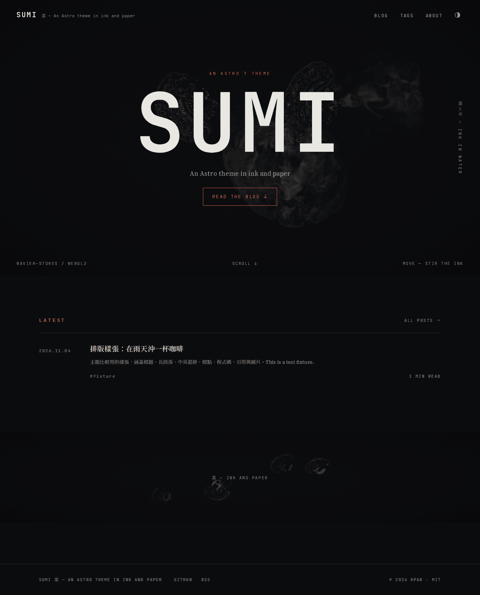

## 2. Gap list against our requirements

Sizes follow the task issues: S (hours), M (a day or two), L (several days). "Either theme" means the work is in the plan already, whichever theme we use.

| Requirement | Sumi today | What it takes on Sumi | Size | Retypeset (PR #121) | Evidence |
|---|---|---|---|---|---|
| zh-TW typesetting: punctuation, CJK–Latin spacing, line height | No CJK rules. The serif stack is Latin-first (`"Source Serif 4"` then CJK), so `——` and `……` take Source Serif's Latin glyphs (thin and low). Blockquotes are `font-style: italic`, which slants CJK synthetically. Body line height is 1.85, which reads well. No automatic CJK–Latin spacing (neither theme has it; the author types the spaces). | Port the CJK rules from Retypeset's `src/styles/markdown.css` (Retypeset's heti-based styles; heti is MIT) to plain CSS. Route CJK punctuation (U+2014, U+2026) to the CJK face with `unicode-range`. Use no italic for `:lang(zh)` quotes. | M | heti-based `.heti` styles with CJK tracking and justified text. `——` and `……` also come from the Latin face (STIX), so the `unicode-range` fix applies here too. | screenshots below; [`prose.css`](https://github.com/kpab/astro-sumi/blob/c6bbdd91417cb0a624e7abbb570544c951ac5c6f/src/styles/prose.css) |
| i18n: `zh-tw` unprefixed, `en` at `/en/` (ADR-0005) | None. One `SITE.lang`; English UI strings hard-coded in 12 places (`Contents`, `min read`, `Skip to content`, …). | Astro `i18n` config, `src/i18n/` string tables, `[...lang]` routes, a language switcher. T11 builds the routes and the switcher on either theme; on Sumi it also adds the string tables and the `i18n` config, which Retypeset already has. | +M on top of T11 | `langMap`, `[...lang]` routes, `src/i18n/ui.ts` with zh-tw and en | spike `grep`; `src/config.ts` |
| Search | None | Pagefind (T12, either theme), with UI styled to Sumi | either theme (T12) | None (T12 adds Pagefind) | spike source |
| KaTeX | Not with Sätteri; works with unified | Switch to the unified processor (proven above) | S | Works | [trial](#katex-and-mermaid-on-sumi) |
| Build-time Mermaid | Not with Sätteri; works with unified | As above, plus the `.label` CSS fix | S | Works | [trial](#katex-and-mermaid-on-sumi) |
| Table of contents | Yes: a right-hand rail on wide screens and a list above the article on narrow ones, from h2–h3, shown with three headings or more. Headings are English (`Contents`). | Localize the heading | S (in i18n) | Yes (`目錄`, collapsible) | screenshots |
| Image captions | No. Images render without a caption (`.prose figcaption` is styled, but nothing emits one). | A small rehype step that wraps an image in `<figure>` with a caption. T12 asks for captions from the image title on either theme. | S, inside T12 | Yes: alt text shown as a caption under the image | screenshots below |
| OG images | Yes, satori + resvg at build time, but the bundled OG font is JetBrains Mono only, so CJK titles render as tofu. That font, [`src/assets/fonts/jetbrains-mono-latin-400.ttf`](https://github.com/kpab/astro-sumi/blob/c6bbdd91417cb0a624e7abbb570544c951ac5c6f/src/assets/fonts/jetbrains-mono-latin-400.ttf), sits outside `public/fonts/`, where the OFL license file is, so a vendoring task must record it in `THIRD_PARTY_NOTICES.md` separately. | Give satori a subset of Noto Serif TC or Noto Sans TC. T13 reworks OG images on either theme. | S, inside T13 | astro-og-canvas with Noto Sans SC (Simplified forms; T13 plans Noto Sans TC) | 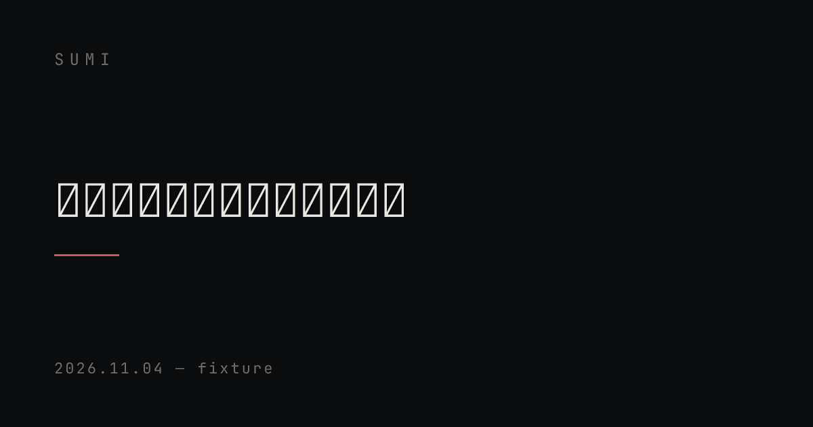 |
| RSS | Yes, one site feed (`rss.xml.ts`, `dc:creator`) | Per-locale and per-topic feeds (T13, either theme) | either theme (T13) | Yes (site feed with XSL) | source |
| Topic hubs and tags | Tags only: `/tags/` and `/tags/<tag>/` with pagination. No topics. | T11 builds topic hubs on either theme. Sumi's URL is `/blog/<slug>/`; Retypeset's is `/posts/<slug>/`. T11 replaces either one. | either theme (T11) | Tags only | source |
| Accessibility (WCAG AA) | Skip link, landmarks, visible focus rings, contrast tuned in both palettes (upstream commit `8702b4d`). axe (WCAG 2.1 A/AA) on the sample post: the only violations are syntax-highlighting tokens (`vitesse-light`, ratios 2.05–4.37; dark 3.93). Home page: none. | Pick an AA-compliant Shiki theme pair, or adjust tokens | S | The same class of failure: code tokens, 2.88–3.97 light, 3.28 dark. PR #121's axe test passes only because its fixture has no code block. | spike axe run |
| No external requests | Holds: self-hosted fonts and no third-party scripts. 0 requests to other hosts on every page and scheme captured. | Keep T09's dist and Playwright host checks | none | Holds (PR #121's tests) | spike request log |
| Dark mode | `light-dark()` tokens; toggle stored in `localStorage`; Shiki dual palettes | none | none | Yes | screenshots |

Both themes use the same Noto Serif TC files and show the same loading behavior (see [font cost](#font-cost-applies-to-either-theme)).

## 3. Prototype

Built in `spikes/` (not committed; deleted before this PR):

- **Sumi** at `c6bbdd9`, Astro 7.4.5. Changes: `SITE.lang: "zh-TW"`; Noto Serif TC added after the Latin faces in `--font-serif` and `--font-mono`; `@fontsource/noto-serif-tc` 5.3.1 weights 400/500/600/700 imported in `BaseLayout.astro`; the sample fixture as its only post. A second copy (`sumi-unified`) adds the unified pipeline above.
- **Retypeset** from PR #121's head `1b40b32`, extracted with `git archive` (the branch was not changed). Changes: `EarlySummer` and `EarlySummer-Subset` replaced by `Noto Serif TC` in `uno.config.ts` (title, navbar, serif; CJK fallback added to mono); the EarlySummer `@font-face` rules and preload removed; the same Fontsource weights imported in `Layout.astro`; **`fontStyle: 'serif'`** (see below); the sample fixture in place of PR #121's fixture post.
- **Sample:** [`tests/fixtures/theme-sample/sample-post.md`](../../tests/fixtures/theme-sample/sample-post.md) and a generated abstract figure. It has headings (h2, h3), a long paragraph, mixed Chinese and English, full-width punctuation, characters whose Ministry of Education forms differ from traditional print forms, a quote, a callout, inline code, a code block, and an image. It is a fixture written for this comparison; nothing comes from `content/` or `drafts/`.
- **Font:** [Noto Serif TC](https://github.com/notofonts/noto-cjk) is the Taiwan member of Noto Serif CJK; its README lists TC as "Traditional Chinese — Taiwan (繁體中文—臺灣)". License: SIL OFL 1.1 with no Reserved Font Name ([`google/fonts` `ofl/notoseriftc/OFL.txt`](https://github.com/google/fonts/blob/main/ofl/notoseriftc/OFL.txt); METADATA: "© 2017-2024 Adobe"; npm `@fontsource/noto-serif-tc` 5.3.1 declares `OFL-1.1`). It is not in this PR.
- **Screenshots:** Playwright Chromium 1248, the same method as PR #121's visual tests: wait for animations to finish, grow the viewport to the page height, then capture; dark and light set through each theme's own `localStorage` key. Palette-quantized to keep the PR small.
- **No external requests:** every capture logged 0 requests to other hosts and 0 console errors.

### Note on Retypeset's font style

Retypeset's upstream config, which PR #121 keeps, is `fontStyle: 'sans'`. In that mode, post bodies use the system sans-serif stack, and EarlySummer Serif only appears in the site title, navigation, and headings. On Apple devices the body is PingFang TC, which already uses Taiwan forms; the sandbox fell back to WenQuanYi Zen Hei. For a serif-to-serif comparison with the same font, the Retypeset prototype uses Retypeset's own `serif` option. If the site stays on Retypeset, the author also chooses between `sans` and `serif`.

## Side-by-side sheet

The same sample and the same Noto Serif TC in both themes. Retypeset on the left, Sumi on the right. Open an image for full size.

### 1280 px, light

| Retypeset (PR #121, serif, Noto Serif TC) | Sumi (`c6bbdd9`, Noto Serif TC) |
|---|---|
| 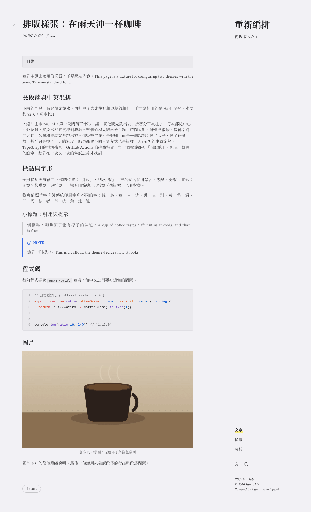 | 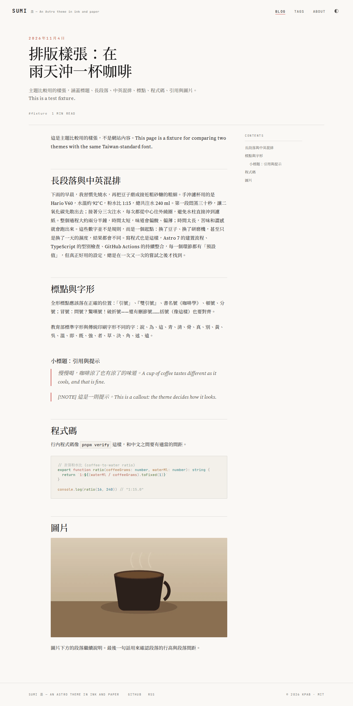 |

### 1280 px, dark

| Retypeset | Sumi |
|---|---|
| 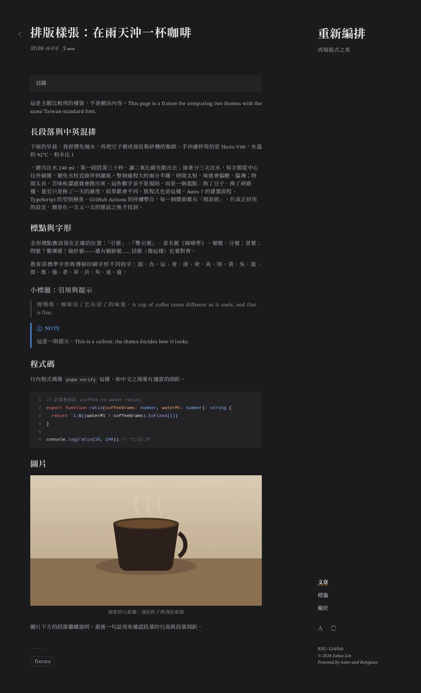 | 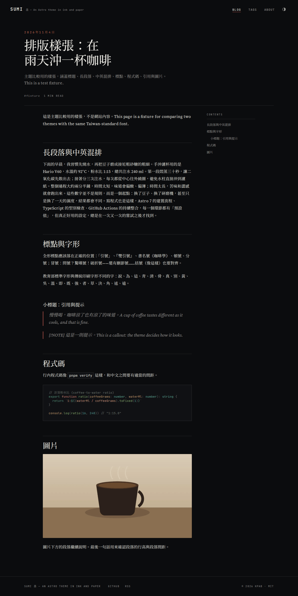 |

### 375 px, light

| Retypeset | Sumi |
|---|---|
| 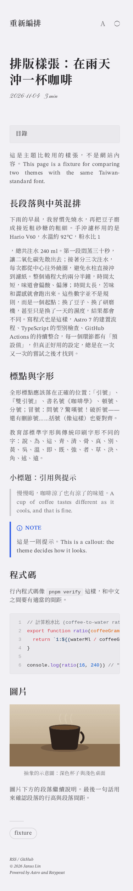 | 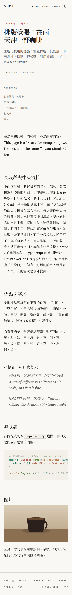 |

### 375 px, dark

| Retypeset | Sumi |
|---|---|
| 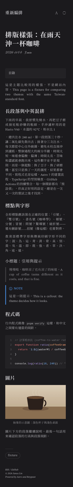 | 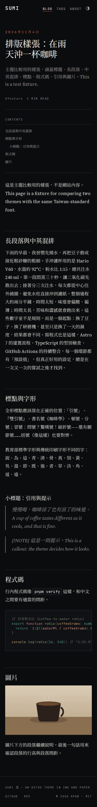 |

### Home pages, for context

| Retypeset `/`, 1280 px, light | Sumi `/`, 1280 px, light | Sumi `/`, 375 px, dark |
|---|---|---|
| 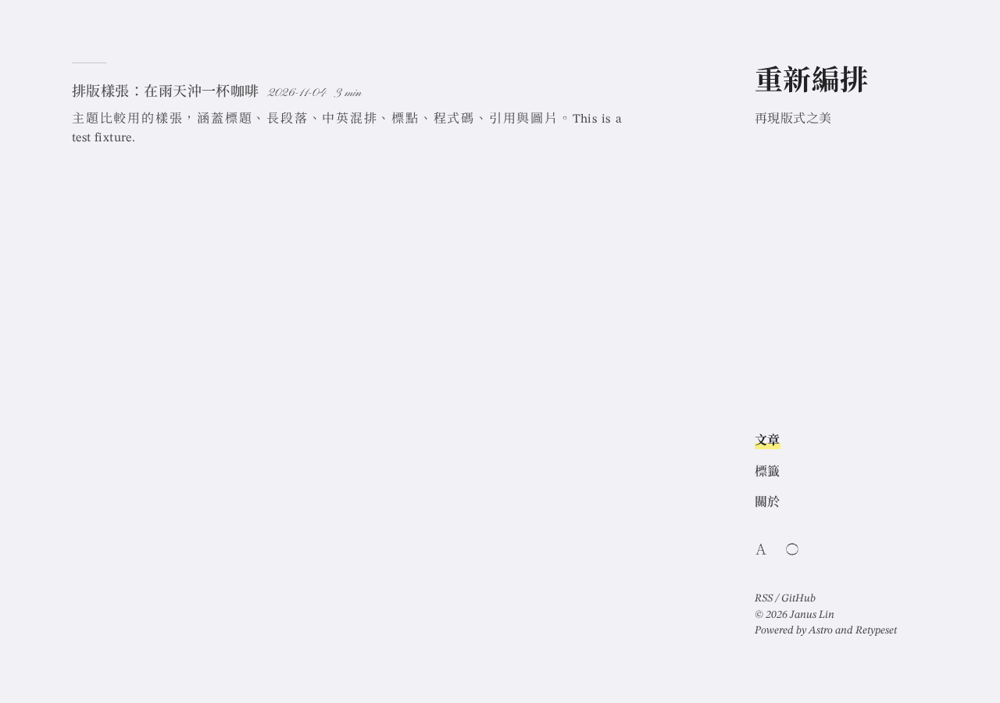 | 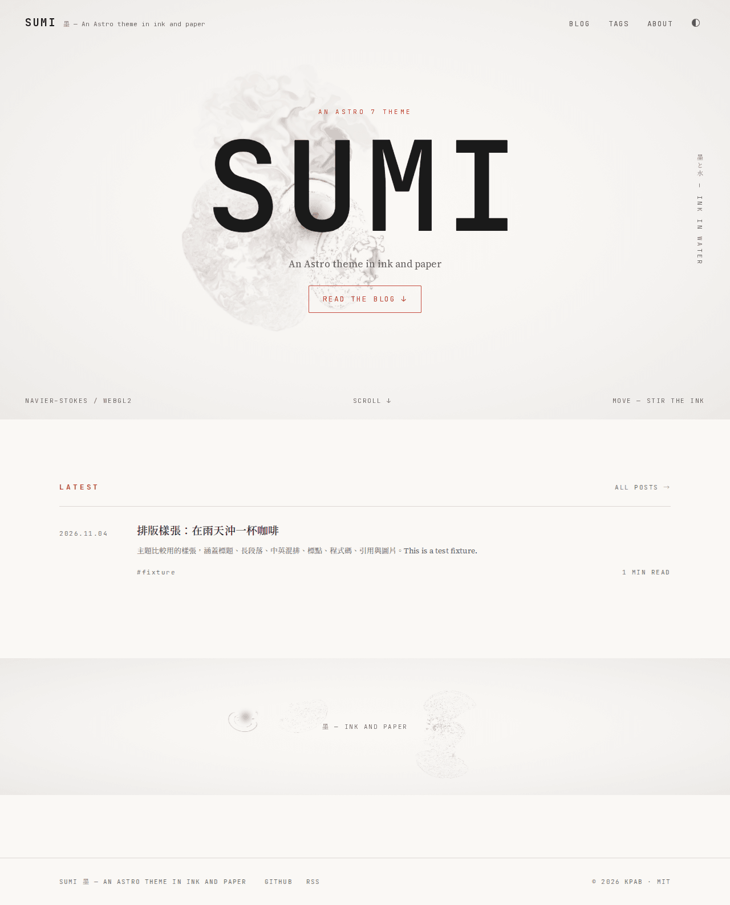 | 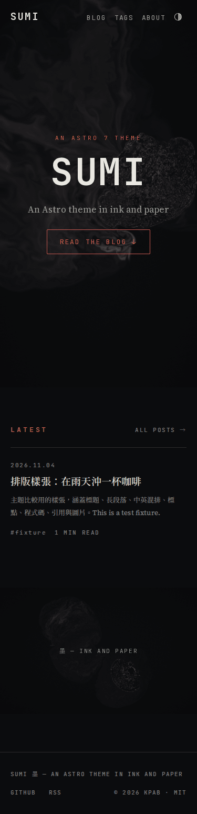 |

### What the screenshots show

- **Layout.** Retypeset puts the site title, navigation, and footer in a fixed right-hand column, with the article on the left and a collapsible TOC above it. Sumi has a top bar, a wide header block (date, title, description, tags, reading time) separated by a rule, the TOC in a right-hand rail, and a rule above every h2.
- **Measure.** At 1280 px Retypeset sets about 40 CJK characters per line, and Sumi about 34, with larger type and more leading. At 375 px, Retypeset justifies text and stretches Latin words in short lines ("two themes with the same Taiwan-"). Sumi stays ragged-right.
- **Retypeset paragraph split.** In Retypeset, the long paragraph breaks after "粉水比 1". `remark-directive` parses `:15` in `1:15` as a text directive. No plugin handles that directive, so `mdast-util-to-hast`'s default handler for unknown nodes emits an empty `
`, and the `:15` is lost. Retypeset's directive plugin handles only container directives and does not cause it. Fix: the directive plugin turns every unhandled text and leaf directive back into its source text. Sumi without directives renders it correctly. Any time or ratio written with a colon before a digit (`10:30`) is affected, so this is a bug for PR #121 and T12 whichever theme is chosen.
- **Punctuation and quotes.** In both themes, `——` and `……` come from the Latin face (Source Serif in Sumi, STIX in Retypeset), because both stacks put the Latin font first. Sumi's quotes are also slanted. These are the typesetting gaps listed above. The punctuation fix applies to either theme.
- **Callout.** Retypeset renders the `NOTE` callout. Sumi shows `[!NOTE]` as text.

## Font cost (applies to either theme)

First load of the sample post, measured with Playwright (`requestfinished` body sizes, scrolled to the end):

| Theme | Font files | Total font bytes | Noto Serif TC files | Noto Serif TC bytes |
|---|---|---|---|---|
| Retypeset, 1280 px | 28 | 1,321,852 | 25 | 1,171,200 |
| Sumi, 1280 px | 24 | 1,284,288 | 21 | 1,000,840 |

PR #121 measured 217,291 bytes for its fixture with EarlySummer. Fontsource splits Noto Serif TC into about 100 unicode-range slices per weight. A short zh-TW post touches about 20 slices, and each heading weight adds its own set. The `@font-face` rules alone make each theme's CSS about 550 KB, because they cover 4 weights × every slice × 5 subsets. T09's 400 KB budget would fail on either theme. The fix: subset at build time to the glyphs the site uses, ship the variable font (one file for all weights), and drop the `latin`, `cyrillic`, and `vietnamese` subsets. That is S–M, needed with any theme that uses Noto Serif TC.

## 4. Recommendation

### Effort to reach T09–T13's acceptance criteria

| Task | Finish on Retypeset | Move to Sumi |
|---|---|---|
| T09 (#58) | Done in PR #121 (approved at `1b40b32`), plus the Noto Serif TC swap and subsetting if the author wants Taiwan forms (S–M), and the `remark-directive` colon fix (S) | Re-do: import Sumi at `c6bbdd9`, switch to unified, port callouts and the CJK typesetting CSS, Noto Serif TC subsetting, remove Japanese accents, decide on the ink. PR #121's test harness carries over unchanged: dist and host checks, Playwright, axe, font bytes, banned names, tsconfig/ESLint split, build-log check. Only the visual baselines and the Retypeset-specific tests (Snell, sounds, callout colors) are redone. **M–L** |
| T10 (#59) | M, unchanged | M, unchanged (the content layer is theme-independent) |
| T11 (#61) | L: replace `/posts/`, add topic hubs, archive, read-next; i18n chrome exists | L + M: the same work, plus the `i18n` config, string tables, and language switcher that Sumi lacks. Sumi's templates are smaller and plain CSS, which offsets part of it. |
| T12 (#63) | M | M: the same, plus the Mermaid `.label` fix and callout styling (S) |
| T13 (#64) | M | M: Sumi's `BaseHead.astro` already emits canonical, OG, Twitter, and `BlogPosting`/`WebSite` JSON-LD, and it has `llms.txt` and `robots.txt` endpoints. T13 still moves them to `src/lib/seo/`. The OG renderer is satori instead of astro-og-canvas. |

Net: Sumi costs about one extra M task (a second T09 and the i18n chrome), minus the parts of T11–T13 that are simpler on Sumi's smaller code. Neither path changes T14–T20.

### Risks

- **Upstream.** Sumi is three months old with one maintainer and no activity since August. We vendor and own the code as we do Retypeset (ADR-0001), so the monthly upstream watch matters less. Upstream fixes are unlikely in either case.
- **CJK typesetting port.** Sumi was designed around Latin and Japanese. The punctuation and quote fixes are CSS, but the result has to be checked by eye in both themes and at both widths. The author reviews the screenshots.
- **The ink.** GPU and battery cost on phones is unmeasured, and the front page misses T16's Lighthouse ≥ 90 target while it runs. Mitigation: ship the static fallback and decide after a real-device test.
- **Work already done.** PR #121's Retypeset-specific work (Astro 7 fixes, the callout contrast decisions, Pinyon Script, removed sounds) is discarded. The author's decisions recorded there (V14) no longer apply.
- **Fonts.** The Noto Serif TC budget problem exists on either theme. It is not a reason to choose one theme over the other.

### Recommendation

Move to Sumi, as ADR-0019 (proposed) sets out. The author prefers its layout. The prototype shows that its gaps are bounded, and that the unified pipeline, KaTeX, and Mermaid carry over. Keep PR #121 on hold until the author decides. If Sumi is accepted, close PR #121 unmerged and keep its test harness for the new T09.

If the author prefers to stay on Retypeset, the same evidence supports finishing PR #121 with three follow-ups: Noto Serif TC with subsetting in place of EarlySummer, the `sans`/`serif` choice, and the `remark-directive` colon fix.

### Task changes needed if Sumi is accepted

Listed only; the issues themselves are not edited here.

- **T09 (#58):** rewrite as "Vendor Sumi, unified pipeline, Taiwan-standard font".
  - Import `kpab/astro-sumi` at `c6bbdd91417cb0a624e7abbb570544c951ac5c6f` as its own commit, without history.
  - Switch to `markdown.processor: unified(...)` with KaTeX and `rehype-mermaid` (`inline-svg`).
  - Callouts: the `:::note` directives that `docs/content-model.md` names, with a fix for the colon issue.
  - Port the CJK typesetting rules. Noto Serif TC with a measured, subset font budget.
  - Remove the Japanese accents, `AGENTS.md`, and `.vscode/`. Decide on the ink (static fallback by default).
  - `THIRD_PARTY_NOTICES.md`: Sumi (MIT), Source Serif 4, JetBrains Mono, and Noto Serif TC (OFL 1.1). Include the OG font `src/assets/fonts/jetbrains-mono-latin-400.ttf`, which sits outside `public/fonts/` and its license file.
  - The directive plugin turns unhandled text and leaf directives back into their source text (the colon issue).
  - Keep PR #121's test list.
  - Drop Snell Roundhand, sound effects, UnoCSS, and the callout-color items.
- **T10 (#59):** replace "The T09 fixture path goes away" with Sumi's collection file. Otherwise unchanged.
- **T11 (#61):** "renders in Retypeset's style" becomes Sumi's style. "Replace Retypeset's `/posts/` structure" becomes Sumi's `/blog/`. Add: the Astro `i18n` config, `src/i18n/` string tables for every hard-coded Sumi string, and the language switcher. "Reading time and TOC (Retypeset behavior)" becomes Sumi behavior.
- **T12 (#63):** "styled to Retypeset" becomes Sumi. "A simple gallery grid if Retypeset lacks one" becomes "if Sumi lacks one" (it does). Add the Mermaid `.label` collision (Sumi's global `.label` rule), callout styling, and image captions.
- **T13 (#64):** the OG font clause ("a subset of Retypeset's bundled CJK font … otherwise a Noto Sans TC subset") becomes "a Noto Serif TC or Noto Sans TC subset for satori". Sumi's `BaseHead.astro` metadata moves to `src/lib/seo/`.
- **Docs, in the task that applies the decision:**
  - ADR-0001 marked superseded by ADR-0019;
  - `AGENTS.md` "Architecture";
  - `docs/overview.md` (purpose, components);
  - `docs/operations.md` (upstream watch: Sumi's last reviewed commit);
  - `docs/roadmap.md` R11 (font specimen);
  - the plan issue #53 ("Retypeset's original design is kept").

## Reproducing the prototype

From a clean checkout, with the pnpm store inside the worktree (`--store-dir`):

1. Download `https://codeload.github.com/kpab/astro-sumi/tar.gz/c6bbdd91417cb0a624e7abbb570544c951ac5c6f` into `spikes/sumi/`.
2. Extract PR #121's tree with `git archive 1b40b32 | tar -x -C spikes/retypeset`.
3. In each: `pnpm add @fontsource/noto-serif-tc@5.3.1`, make the changes listed under [Prototype](#3-prototype), copy `tests/fixtures/theme-sample/*` into the collection folder, and run `pnpm exec astro build` (Retypeset: `pnpm build`).
4. Serve each `dist/` and capture with Playwright as described.

No spike file is committed.
