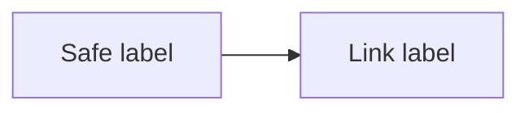

This page is a test fixture for content safety.

An image with an event handler: 

<iframe src="https://example.com/embed"></iframe>

<object data="https://example.com/x.swf"></object><embed src="https://example.com/x.swf">

<!-- An HTML comment is removed. -->

A [javascript link](javascript:alert('link')) and an [ordinary link](https://example.com/).

A [mixed-case javascript link](JaVaScRiPt:alert('mixed')) and an autolink <javascript:alert('auto')>.

