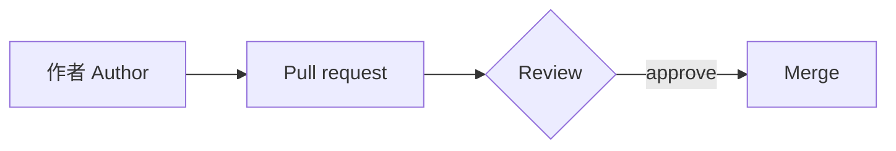

這是建置測試用的頁面，不是網站內容。This page is a test fixture for the build: it exercises the rich content the theme renders at build time.

## 數學 Math

質能等價寫成 $E = mc^2$，行內公式應與文字同一行。

$$
\int_{-\infty}^{\infty} e^{-x^2}\,dx = \sqrt{\pi}
$$

## 圖表 Mermaid

## 提示 Callout

> [!NOTE]
> 這是一則提示。This is a callout.

## 註腳 Footnote

排版是一門古老的手藝。[^1]

[^1]: Typography is an old craft; this sentence carries the footnote.
