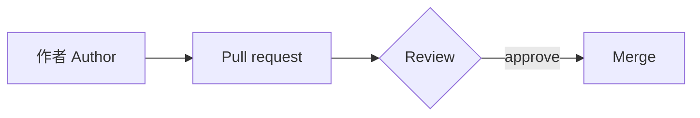

---
# Test fixture for the site build (T09, #58), not site content. Until T10 the posts
# collection reads tests/fixtures/site/posts/, never content/.
title: 測試頁面：在雨天沖一杯咖啡
description: 建置測試用的頁面，涵蓋數學、圖表、提示、註腳、程式碼與圖片。A test fixture for the site build.
pubDate: 2026-01-15
tags:
  - fixture
---

這是建置測試用的頁面，不是網站內容。This page is a test fixture for the build: it exercises the rich content the theme renders at build time.

## 長段落與中英混排

下雨的早晨，我習慣先燒水，再把豆子磨成接近粗砂糖的粗細。手沖濾杯用的是 Hario V60，水溫約 92°C，粉水比 1:15，總共注水 240 ml，早上 10:30 前喝完。第一段悶蒸三十秒，讓二氧化碳先散出去；接著分三次注水，每次都從中心往外繞圈。寫程式也是這樣，Astro 7 的建置流程、TypeScript 的型別檢查、GitHub Actions 的持續整合，每一個環節都有「預設值」，但真正好用的設定，總是在一次又一次的嘗試之後才找到。

## 標點與字形

全形標點應該落在正確的位置：「引號」、『雙引號』、書名號《咖啡學》、頓號、分號；冒號：問號？驚嘆號！破折號——還有刪節號……括號（像這樣）也要對齊。

教育部標準字形與傳統印刷字形不同的字：說、為、這、青、清、骨、真、別、黃、吳、溫、即、既、強、者、草、決、角、述、遠。

> 慢慢喝，咖啡涼了也有涼了的味道。*強調的文字*不應該是斜體。A cup of coffee tastes different as it cools.

## 數學 Math

質能等價寫成 $E = mc^2$，行內公式應與文字同一行。

$$
\int_{-\infty}^{\infty} e^{-x^2}\,dx = \sqrt{\pi}
$$

## 圖表 Mermaid



## 提示 Callouts

:::note
這是一則提示。This is a note.
:::

:::tip
小技巧。A tip.
:::

:::important
重要事項。Something important.
:::

:::warning
警告。A warning.
:::

:::caution
注意。A caution.
:::

## 程式碼 Code

行內程式碼像 `pnpm verify` 這樣。

```ts
// 計算粉水比 (coffee-to-water ratio)
export function ratio(coffeeGrams: number, waterMl: number): string {
  return `1:${(waterMl / coffeeGrams).toFixed(1)}`;
}

console.log(ratio(16, 240)); // "1:15.0"
```

## 圖片 Image


## 註腳 Footnote

排版是一門古老的手藝。[^1]

[^1]: Typography is an old craft; this sentence carries the footnote.
